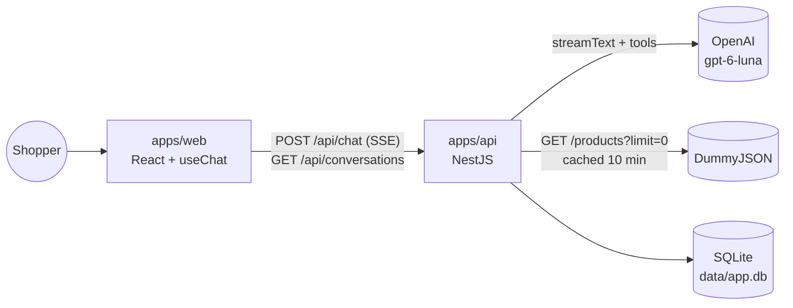

# AI Shopping Copilot

A chat assistant that turns a shopping request into a search over the DummyJSON catalog and shows the real Products as cards inside the chat. NestJS API + React web app, TypeScript throughout, model `gpt-6-luna`.

## Setup and run

Requires Node ≥ 22.12 (I built it on Node 26).

```bash
npm install
cp .env.example .env        # then set OPENAI_KEY
npm run dev
```

- Web: http://localhost:5173. The shop page with the copilot as a floating ✦ widget; ⤢ opens the same chat full page at `/chat/:id`.
- API: http://localhost:3001/api.
- The API won't start without `OPENAI_KEY`, or with any model other than `gpt-6-luna`.
- Conversations are stored in `data/app.db` (SQLite, created on first start). Delete the file to reset.

| Command                                                | What it does                                                                                                                                         |
| ------------------------------------------------------ | ---------------------------------------------------------------------------------------------------------------------------------------------------- |
| `npm test`                                             | All unit, component and API e2e tests. Offline: no key, no network (mock model, fake catalog, in-memory DB).                                         |
| `npm run eval`                                         | 7 live cases against `gpt-6-luna` and the real catalog (~40 s, a few cents). Writes the result table to `docs/qa-report.md`, exits 1 on any failure. |
| `npm run lint` · `npm run typecheck` · `npm run build` | Static checks and production build.                                                                                                                  |

## Architecture & framework choice



I used the **Vercel AI SDK v7** (ADR 0001). The assignment has three hard parts: a tool-calling loop, token streaming with tool results mixed in, and chat state in the browser. The SDK covers all three. `streamText` runs the loop in the API (two tools, at most 3 steps, last step text only), a NestJS controller pipes its UI message stream (SSE), and `useChat` renders it. It also solved a gpt-6-luna quirk: the model rejects function tools on `/chat/completions`, and the SDK uses the Responses API. SDK types stay in two adapter folders. The database stores my own `Message` shape, so switching frameworks would touch only those adapters.

Alternatives I rejected:

- **From scratch with the `openai` SDK.** About 200 extra lines for the tool loop, stream protocol and client parser. That's an hour of a 3-hour budget with nothing the user would see.
- **LangChain / Mastra.** Mastra brings its own server and storage, which would compete with NestJS. LangChain adds layers of abstraction around what is a single tool loop.
- **assistant-ui / CopilotKit.** They own the whole chat UI (and CopilotKit a backend runtime), which hides exactly the streaming and persistence logic this README has to explain.
- **The Decisions API as an intent classifier.** It needed fields that weren't documented (three failed attempts), and a classifier still needs a second call to write the reply.

The repo is npm workspaces: `apps/api`, `apps/web`, and `packages/contracts` for the zod schemas both sides share. The API has three Nest modules (`catalog`, `conversations`, `assistant`), each split into domain / application / infrastructure / presentation, with OpenAI, DummyJSON and SQLite behind ports. Business logic lives in pure functions that are tested without mocks; services only do I/O.

## Retrieval strategy

I call one DummyJSON endpoint: `GET /products?limit=0`. It returns all 194 Products, which the API caches for about 10 minutes (5 s timeout; if DummyJSON is down, it serves the stale copy). Chat search, the details popup and the shop grid all read from this copy. I tried the API's own search first and it didn't fit: `search?q=` is a substring match ("cheap" → 0 results, "smartphone phone" → 0, "phone" also returns phone accessories), there is no price filter (`maxPrice` is silently ignored), and `sortBy` is only documented on `/products`. At this catalog size, filtering in memory is simpler and exact (ADR 0002).

**The model decides the query by filling in a tool.** `search_products` takes `category` (an enum of the 24 real slugs, or null), single-word `keywords`, `minPrice`/`maxPrice`, `sortBy`, `offset`, and `confidence: clear | guessed` with an `assumption` that the schema requires when the search is a guess. Confidence is a label rather than a number, because a model's self-reported number isn't calibrated. The code then does the part that has to be right: `filterProducts` (a pure function) drops out-of-stock items, matches category, matches keywords inside words with title weighted above description, applies the exact price range, sorts, and returns 4 cards plus a total. Cards render only from tool output, so the model can't put an invented Product on screen.

**Similar Products come from local embeddings** (ADR 0004). Keywords miss requests that share no word with the Product, like "cellphone" or "something for the beach". gpt-6-luna can't create embeddings and `text-embedding-3-small` isn't an allowed model, so I run `all-MiniLM-L6-v2` in-process: 24 MB, downloaded once into `data/models/`, 2–3 ms per query. The model also fills in `semanticQuery`, a longer description of what would fit. The code embeds it and adds a ✨ "You might also like" group under the matches: cosine ≥ 0.35, the same price and stock filters, any category, at most 4 cards, and nothing from the page already shown. Until the model has loaded, or if loading fails, search returns matches only.

**A search with no keywords is ordered by similarity.** QA found that "something for the beach" returned the whole catalog sorted by rating: "Beach essentials 1–4 of 190" was an Echo, a Matebook, a Rolex and water. Now a relevance search without keywords orders every Product by similarity to `semanticQuery`. It does this on every page, so "Show more" doesn't repeat or skip Products. Rating order is the fallback while the model is loading. I didn't filter the matches by 0.35 instead, because that would duplicate the Recommended Group and leave most broad searches empty. The trade-off is that the most similar Products now fill the match page, so the Recommended Group gets shorter (beach went from 4 to 1) and can show what "Show more" would show next. The eval passed 7/7 with this bug because no rule checked meaning. The beach case now has a `relevant` rule that requires every match card to be in a beach category. I chose that over an LLM judge to keep the eval deterministic.

- **Ambiguous** ("something cheap and cool"): I'd rather show something than block on a question. The model makes a guessed search (for example sunglasses under $50, cheapest first), the group carries a 💡 Assumption chip, and the reply ends with one question to narrow it down.
- **Off-catalog** ("a flight to Tokyo"): the model calls `report_off_catalog`, the chat shows "Not sold here", and any suggestions are real search results. An early version searched for "flight" three times and then replied with nothing; I fixed it by forcing the last step to be text only.
- **Multi-intent** ("a phone under $500 and a lipstick"): the model makes two parallel tool calls, and each becomes its own Product Group.
- **Follow-ups** ("cheaper ones", "show more"): the model sees the last 20 Messages plus system notes listing the Products already shown (id, title, price and the search used). "Show more" reuses the stored search in code, so only the offset comes from the model. Before that fix, the model changed the sort order and a Product repeated.

## Conversation & state

I keep Conversations on the server, in a SQLite file (`data/app.db`, Node's built-in `node:sqlite`) with one row per Message. The browser sends only the new Message, and the server loads the history itself, so nobody can change what the model sees from the browser (ADR 0003). The model gets the last 20 Messages plus the Product notes described under Retrieval. The browser keeps only a pointer: the full page has the Conversation id in the URL, and the widget keeps `{ open, conversationId }` in localStorage.

I rejected localStorage because clearing site data would lose the chat mid-conversation, the ~5 MB quota fills up with Product Groups, and history sent from the client can be edited. IndexedDB has the same loss-on-clear problem. The cost of the server approach is that, with no auth, everyone on one server shares one Conversation list.

What happens when things go wrong:

- **Browser storage cleared:** nothing is lost. The widget starts a new chat, and every Conversation is still in the list.
- **Corrupted data:** each Message is checked with zod when it's read. A bad row is skipped and logged, and the rest of the chat loads. A bad widget pointer just opens a new chat.
- **Storage full or a write fails:** the Shopper's Message is saved before the model runs. If saving the reply fails, the Shopper still sees it stream, followed by "Your reply was shown but could not be saved."
- **Tab closed mid-reply:** the server keeps reading the stream, so the reply is still saved.
- **Model error mid-stream:** the partial text stays, with a Retry button.

One gap: if `data/app.db` is deleted while the API runs, nothing crashes, but the chats are gone after a restart and the page shows "Conversation not found". No test covers this.

## Evaluation

There are two suites, split by cost. `npm test` runs offline with no key: pure functions, React components, and API e2e tests that run a whole turn with the AI SDK's `MockLanguageModel`, a fake Catalog, a fake embedder and in-memory SQLite. Each e2e test posts a message, checks that the stream carries tool output and then text, and reads the Conversation back to confirm both Messages were saved.

`npm run eval` runs 7 cases against `gpt-6-luna` and the real Catalog: plain, price, ambiguous, off-catalog, multi-intent, follow-up and beach. I check the rules in code on the saved Message instead of asking an LLM judge, so a failure always means the same thing. The rules: every Product is real, in stock and within the price limit; at most 4 cards; a guessed search has an Assumption and a question; off-catalog calls `report_off_catalog`; one group per intent; a follow-up is cheaper than the previous result; recommendations don't repeat matches; and beach matches come from beach categories. It writes the table to `docs/qa-report.md` and exits 1 on any failure. It isn't part of `npm test` because it costs money and its results can vary.

The eval earned its place. After S8 it went from 5/7 to 7/7: a broad search left nothing to recommend, and recommendations depended on the order of tool calls. Earlier live runs found the model searching for "flight" three times without replying, "Show more" changing the sort order, and empty "Travel bags" groups under off-catalog replies.

What gets through:

- **Meaning:** Q1 passed 7/7 while showing an Echo under "Beach essentials". Only the beach case checks relevance now.
- **Wording:** tone, and whether an Assumption makes sense, aren't checked.
- **Model variance:** each case runs once, so a pass means the feature worked once, not a pass rate.
- **Threshold:** whether 0.35 is right beyond these 7 cases.
- **The real embedding model download:** tests use a fake embedder.
- **Layout:** checked by hand in Chrome; there's no Playwright.

## Known limitations

The weakest part is relevance. Results are only as good as the category and keywords the model puts in the tool, and only the beach eval case checks meaning. After the Q1 fix, a broad search fills the match page with the most similar Products, so the Recommended Group is often short and can show what "Show more" would show next. Off-catalog replies sometimes add an "Instead: …" search that comes back empty.

It's also slow: about 5–6 s per turn with tools, and "Show more" costs another model call because it goes through the LLM instead of a paging endpoint. The local embedding model adds about 470 MB to `node_modules`. If it fails to load, every search retries and logs a warning. In a multi-intent turn, a recommendation can repeat a Product from the other intent. A bad API key gets the same "try again" message as a temporary failure, so Retry can't help, and `minPrice > maxPrice` isn't rejected and just returns an empty group. Scope cuts: no auth (one shared Conversation list), English and USD only, no stop button or rename, and titles are the first ~40 characters.

With another week, in this order:

1. Run each eval case N times and report a pass rate, and add cases for 0 results, Show more and prompt injection in Product text.
2. Tune the 0.35 threshold on a labelled set (recall@k) and check relevance on every case.
3. Fix the small ones: empty off-catalog groups, a clear auth error, reject `minPrice > maxPrice`, back off after a failed model load.
4. Add Playwright tests for streaming, cards and reload.
5. Add auth with a `shopperId`, a stop button, and code-splitting.
6. For a large catalog, move to Postgres with pgvector and pg_search (hybrid search) behind the same ports.

## How this was built

I built it with Claude Code as a chain of project skills in `.claude/skills/`: `/product` → `/architect` → `/designer` → `/developer` (one slice at a time, S0–S8) → `/qa` → `/readme` → `/interview`. They share one `PROTOCOL.md`: the skill proposes 2–3 options with trade-offs, I pick, and the choice is recorded. `docs/ai-log/SESSION-LOG.md` has every decision with the options I rejected; `docs/ai-log/CONVERSATION.md` is the raw prompt log, written by hooks with secrets redacted. ADRs are in `docs/adr/`.
